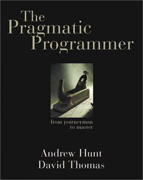

<table class="image">
    <caption align="bottom"><strong>Book cover</strong></caption>
    <tr>
        <td style="text-align: center;">
            
        </td>
    </tr>
</table>

What a joy programming is, isn't it? Problem solving concepts are widely accepted, learnings are shared among the industry, and things hardly change over the years. After reading this book, you might believe this is how software development actually is, all of the questions have already been answered. That's the fanscinating thing about this book, it stands the test of time unlike any other software book I have read. In reality, there are usually no hard-set answers to much things, tradeoffs are always made and the technology developers are using changes rapidly.

I was recommended this book from several senior developers who mentored me in early in my career as a developer, and I can't thank them enough for doing so. I would say when I was sort of just getting out of the junior developer phase, I felt extremely overwhelmed with how much was out there when it came to the "right answer" when solving problems. This book just has so much good advice, from unconventional soft skills to classical hard skills. This book has a ton of advice in it which I would deem as fundemental to any developer who is serious about their career.

So without further adue, here are some highlights I made as I read this book on my Kindle.

> ...if the bug is the result of someone's wrong assumption, discuss the problem with the whole team: if one person misunderstands, then it's possible many people do.

I love this one, it really harps the fact that tight communication about the domain you are working in is key for a teams success.

> Don't be a slave to history. Don't let existing code dictate future code. All code can be replaced if it is no longer appropriate. Even within one program, don't let what you've already done constrain what you do next—be ready to refactor. This decision may impact the project schedule. The assumption is that the impact will be less than the cost of not making the change.

One mis-conception I once had was the thought of pigeon-holing yourself to a project/code-bases conventions, either be stylistically or architecturally. One strategy that I have had success with is not being afraid to eliminate code smells and to really challenge at all steps old code, either be your own or your team-mates.

> Rather than construction, software is more like gardening—it is more organic than concrete.

This is similar to the last quote, never be afraid to figure out better ways to do things, even mid-project. Half of the project being readable, tested, and scalable is better than none at all.

> At its heart, refactoring is redesign. Anything that you or others on your team designed can be redesigned in light of new facts, deeper understandings, changing requirements, and so on. But if you proceed to rip up vast quantities of code with wild abandon, you may find yourself in a worse position than when you started.

Seems basic right? I would say refactoring without unit-tests is like driving at night without head-lights, you have zero visibility. How do you know if your refactoring is doing any harm? In most cases I have been, a business usually doesn't want to invest in regression testing when it comes to large systems. Writing great unit-tests for an existing system gives the developer a blank slate to work with, you can rip up anything and still know your modules still do what they are intended to do.

> At its heart, refactoring is redesign. Anything that you or others on your team designed can be redesigned in light of new facts, deeper understandings, changing requirements, and so on. But if you proceed to rip up vast quantities of code with wild abandon, you may find yourself in a worse position than when you started.

Unit testing is not easy, especially if you want to get as close to the "metal" of the modules within a code base.

### References

Hunt, Andrew. The Pragmatic Programmer: From Journeyman to Master (Kindle Locations 1909-1910). Pearson Education. Kindle Edition.
