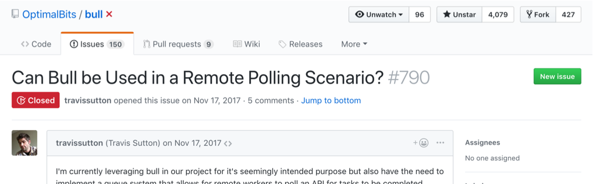

> An in-depth explanation into why we invested in the open source package, <a href="https://github.com/OptimalBits/bull" target="_blank">Bull</a>, even though it didn't quite fit our needs.

Into the microservice world we go, exploring where no developer has gone before. When switching to a service oriented stack versus the ol' monolith, new problems arise. The simple async job processor of the past doesn't fit in this new architecture. We found <a href="https://github.com/OptimalBits/bull" target="_blank">Bull</a>, a Node.js package, to cover our needs, but needed tweaks to work in this new world.

If you have one service which performs a task, e.g. an image processor, and another service which needs to queue jobs to it, we cannot use traditional technology. I am of course mentioning things like DelayedJob or Celery which you may be familiar with. Keeping it 2018, this Node.js package is lightning fast, built to work with Redis and has an active community. It didn't quite fit our needs at first as it processed jobs in the same app as the queue-mechanism. This is fine for traditional apps, but for our setup we needed to manage jobs **across systems**.

<table class="image">
  <caption align="bottom">This</caption>
  <tr><td></td></tr>
</table>

versus

<table class="image">
  <caption align="bottom">This</caption>
  <tr><td></td></tr>
</table>

We needed to make this work in an async fashion where the worker may not be in the same repo or service as the service running Bull itself. Bull had a simple way to define the processing logic:

```javascript
queue.process(async () => {
  doWork()
})
```

This way, whenever a job came into a waiting queue, Bull knew how to process it and throw it to the completed queue. You may be thinking, "to work in this new fashion, how about we just don't define this method?", we tried this out, and it _worked!_. We now need to manage the queue manually, but that's to be expected. Forward into the weeds we go.

> How about we just don't define the process method?

We need to think about how we want to manage a jobs life-cycle. Good thing someone contributed a diagram quite recently to the project.

<table class="image">
  <caption align="bottom">Job Lifecycle Diagram</caption>
  <tr><td></td></tr>
</table>

After digging into the code more, Bull defines state transition methods on two simple objects, `Job` and `Queue`.

Some methods are private though! This means that the authors didn't indeed for these methods to be used publicly. What did we need to do, to make these public? After some more digging, we found someone else trying to do the same thing as us.

<table class="image">
  <caption align="bottom">The issue can be found <a href="https://github.com/OptimalBits/bull/issues/790" target="_blank">here.</a></caption>
  <tr><td>
    
  </td></tr>
</table>

Just using the library as is would have been fine but we are **professional developers.**

> I would recommend that you write a few unit tests specifically for testing the code using the private functions... - @manast

The maintainer had a great suggestion, write unit tests for the private functions. The next best thing for this would be to at least write documentation for the functions so that they are understood by the community and strengthened their viability to be used publicly. And that's what we <a href="https://github.com/OptimalBits/bull/pull/1017/files#diff-d823dceb04482ab55e5004eebb53fc1cR182" target="_blank">did</a>. For the actual pattern we described at the beginning, an addition to the reference docs <a href="https://github.com/OptimalBits/bull/pull/1017/files#diff-375fc823554b090375d9c47199cb5ee2R201" target="_blank">were added</a> to make this a viable pattern. Making this a known pattern encourages usage of the feature and possibly leading to other users finding issues when using in production. Typescript types were also available so we updated <a href="https://github.com/DefinitelyTyped/DefinitelyTyped/pull/27816" target="_blank">those</a> as well. After using it for some time (processing approx. 500k jobs), we found a bug and <a href="https://github.com/OptimalBits/bull/pull/1096" target="_blank">were able to easily fix it</a> using our extended knowledge of the package. Talk about bringing a third class feature to first class!

I am very happy with the outcome of the project as not only did we satisfy our requirements but also made open source contributions. This led to us understanding the packages internals and also led to us being able to easily add features for our use case. Having an active maintainer on the project who knew the ins and outside also made the entire process run smoothly.
